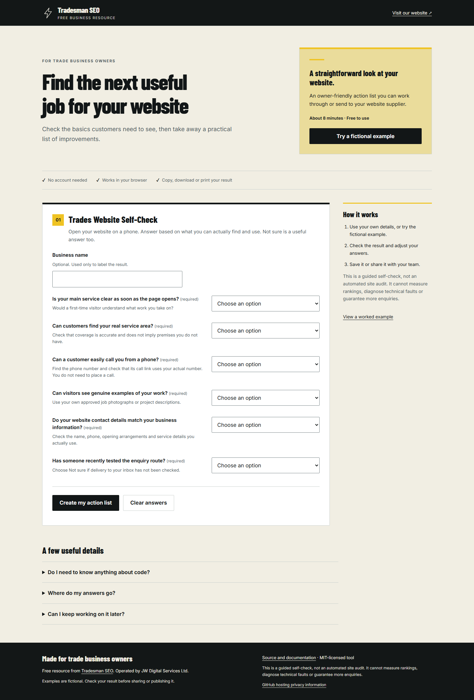

# Trades Site Audit Kit

Trades Site Audit Kit checks a local HTML export for a small set of visible website issues. Each finding includes the page, the observed evidence and a suggested next check, so the output is useful to the person fixing it.

It does not research keywords, inspect Google accounts or predict rankings. Intentional publishing settings need an owner's decision. Maintained by [Tradesman SEO](https://tradesmanseo.co.uk/), operated by JW Digital Services Ltd.



## Live demo

[Open the sample audit report](https://tradesman-seo.github.io/trades-site-audit-kit/). The audit itself runs locally in Node.js; the hosted page shows its synthetic report. GitHub provides the hosting and handles request logs.

## Start locally

Requires Node.js 22 or later. Install the locked HTML-parser dependency with `npm ci`.

```sh
npm ci
npm test
npm run build
npm run serve
```

Open http://127.0.0.1:4173/ for the complete local demonstration. Browser examples do not upload or persist entered data. The optional development server binds to loopback only.

## Input and output

Supply site, baseUrl and pages [{url,html}]. HTML is parsed with parse5 locally. The CLI also accepts --manifest manifest.json to read exported files within the manifest directory. No crawling or network requests.

Use [examples/input.json](examples/input.json) as the complete input contract. Compare the generated [JSON result](examples/output.json), [Markdown report](examples/output.md) and [complete HTML](examples/output.html). The demo is in [demo/index.html](demo/index.html). It needs the local server for JavaScript modules. HTML reports can be opened as standalone files.

```sh
node cli.mjs examples/input.json --format json
node cli.mjs examples/input.json --format html --output report.html
node cli.mjs examples/input.json --format md --output report.md
```

For exported files, use `node cli.mjs --manifest examples/export/manifest.json`. Export files must stay inside the manifest directory. The tool never fetches a site.

## Worked example

Use a fictional three-page trade site with a missing title, conflicting canonicals, a malformed telephone link and one intentionally noindex draft. Include a correct control page so the report demonstrates both findings and restraint. The expected action list leaves the draft's indexing decision to its owner.

All supplied example records are synthetic. No clients, outcomes, current professional advice or real service availability are represented by them. Keep real records private and review output before sharing it.

## Checks

- Each rule has a failing fixture and a correct control. Reports identify the exact source page and evidence.
- Intentional noindex is reported for review, never edited or labelled automatically as a launch defect.
- Malformed HTML, absolute and relative links, encoded paths and empty fields are handled without crashing.
- Source content cannot inject executable markup into reports. All input files remain local and unchanged.
- No generic SEO score, invented search volume or fabricated result appears in the output.

The automated results and browser checks performed for this release are recorded in [verification.md](docs/verification.md). Manual screen-reader testing has not been performed. A passing automated check is not accessibility certification.

## Contribute and maintain

Use [Issues](https://github.com/Tradesman-SEO/trades-site-audit-kit/issues) for a reproducible bug and [Discussions](https://github.com/Tradesman-SEO/trades-site-audit-kit/discussions) for questions and improvements. Follow [CONTRIBUTING.md](CONTRIBUTING.md); report vulnerabilities privately using [SECURITY.md](SECURITY.md). See [CHANGELOG.md](CHANGELOG.md) for releases. Maintenance is best effort.

Code, original illustrations and synthetic fixtures are MIT licensed. There is no required website backlink when reusing the resource. Commercial brand assets and third-party material are not included.
